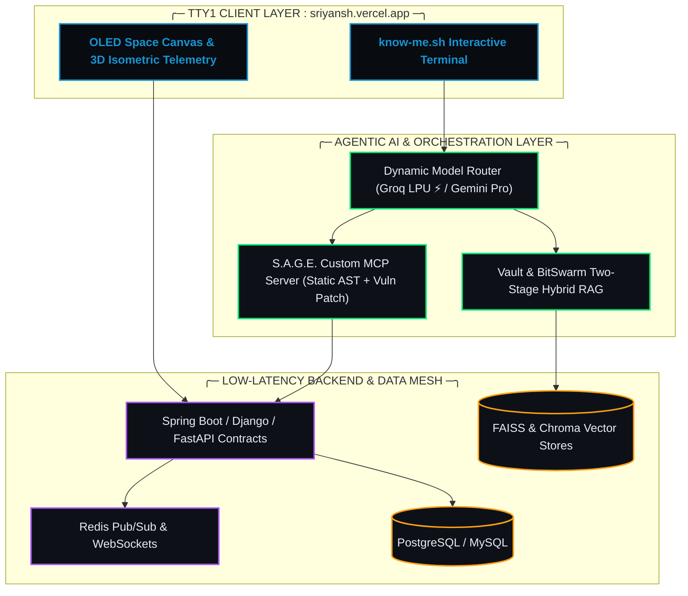

<div align="center">

<!-- ========================================================================================= -->
<!-- CYBERNETIC ARCH LINUX HUD HEADER                                                          -->
<!-- ========================================================================================= -->
<a href="https://sriyansh.vercel.app">
  
</a>

<!-- LIVE MULTIPLEXED TTY1 BOOT SEQUENCE -->
<a href="https://sriyansh.vercel.app/?view=know-me">
  
</a>

<br/>

<!-- HARDWARE TACTILE TTY MULTIPLEXER BAR -->
<kbd><a href="https://sriyansh.vercel.app">⚡ <b>tty1: Live Terminal OS</b></a></kbd> · 
<kbd><a href="https://sriyansh.vercel.app/?view=know-me">🐚 <b>tty2: AI Shell (know-me.sh)</b></a></kbd> · 
<kbd><a href="https://sriyansh.vercel.app/?view=plan">🧠 <b>tty3: System Mindmap</b></a></kbd> · 
<kbd><a href="https://sriyansh.vercel.app/?post=this-counts">🏙️ <b>tty4: 3D Isometric Cities</b></a></kbd> · 
<kbd><a href="https://sriyansh.vercel.app/?post=the-scoreboard">📊 <b>tty5: The Scoreboard</b></a></kbd>

<br/><br/>

<!-- COMMAND BADGES -->
<a href="https://sriyansh.vercel.app"></a>
<a href="https://sriyansh.vercel.app/?view=know-me"></a>
<a href="https://linkedin.com/in/sriyanshraj"></a>
<a href="https://leetcode.com/u/sriyansh-dev/"></a>
<a href="https://codolio.com/profile/sriyansh_dev"></a>


</div>

<br/>

> [!IMPORTANT]
> **INTERACTIVE AI SHELL ONLINE (`know-me.sh`)** — Skip static resumes. Query my live first-person Groq-powered AI agent directly in the browser at **[sriyansh.vercel.app/?view=know-me](https://sriyansh.vercel.app/?view=know-me)** or inspect my 3D isometric contribution telemetry at **[sriyansh.vercel.app/?post=this-counts](https://sriyansh.vercel.app/?post=this-counts)**.

---

### `┏━( arch@sriyansh : ~/hypervisor )━[ tmux attach -t 0 ]`

<table width="100%">
<tr>
<td width="52%" valign="top">

```yaml
# ╭─ 01: /etc/sriyansh.conf (fastfetch) ─────────╮
host: "sriyansh.vercel.app"
os: "Arch Linux x86_64 (tty1)"
kernel: "6.12.0-arch1-performance"
role: "Generative AI & Backend Systems Engineer"
shell: "know-me.sh (Groq LPU Conversational Agent)"
uptime: "3x AI/ML Engineering Internships Shipped"

architecture_focus:
  - "Autonomous Agentic Workflows & Custom MCP"
  - "Two-Stage Hybrid RAG (Dense + Sparse Vectors)"
  - "Low-Latency Distributed REST & WebSockets"

engineering_doctrine:
  superpower: "Sub-100ms APIs & clean contracts"
  motto: "No fluff, no filler text, no bloated code."
  status: "[ONLINE] Open to High-Impact Roles"
```

</td>
<td width="48%" valign="top">

```diff
+ ╭─ 02: BTOP // LIVE TELEMETRY & DAEMONS ───────╮

+ AGENTIC AI / MCP / RAG   [███████████████████░] 96%
+ BACKEND / SPRING / REDIS [██████████████████░░] 94%
+ PYTHON / JAVA / TS / C++ [██████████████████░░] 92%
+ VECTOR DB (FAISS/CHROMA) [█████████████████░░░] 90%
+ ALGORITHMS & SYS DESIGN  [█████████████████░░░] 89%

! ACTIVE SYSTEM DAEMONS (systemctl --type=service)
+ [PID 1042] sage-mcp-server.d     :: AST Security
+ [PID 1088] vault-bitswarm-rag.d  :: 2-Stage RAG
+ [PID 1104] know-me-groq-shell.d  :: LPU Agent CLI
+ [PID 1156] fact-check-engine.d   :: DOM Verifier
```

</td>
</tr>
</table>

---

### `┏━( arch@sriyansh : ~/architecture )━[ ./render-neural-topology.sh ]`



---

### `┏━( arch@sriyansh : ~/flagship-daemons )━[ ls -lha --interactive ]`
> 💡 **Click any daemon module below** to inspect its execution pipeline, protocol design, and live deployment links.

<details open>
<summary><b>🔴 <kbd>PID:1042</kbd> S.A.G.E. — Open-Source Agentic Code Review Engine (Custom MCP Server)</b></summary>
<br/>

```yaml
daemon: "sage-code-reviewer.service"
protocol: "Custom Model Context Protocol (MCP) Server"
engine: "Google Gemini + Hybrid RAG AST Vulnerability Scanner"
repository: "[https://github.com/sriyansh-dev/S.A.G.E](https://github.com/sriyansh-dev/S.A.G.E)"
```
- **Architecture:** Autonomous code-review engine that parses repository Abstract Syntax Trees (AST), detects security flaws and performance bottlenecks, and synthesizes deterministic optimization diffs.
- **Tech Stack:**     

</details>

<details open>
<summary><b>🟣 <kbd>PID:1088</kbd> Vault & BitSwarm RAG — Autonomous Multi-Stage Knowledge Engine</b></summary>
<br/>

```yaml
daemon: "vault-bitswarm-rag.service"
protocol: "Two-Stage Retrieval-Augmented Generation (Dense + Sparse)"
routing: "Dynamic Latency-Aware LLM Router (Groq LPU / Gemini)"
deployment: "[https://sriyansh.vercel.app](https://sriyansh.vercel.app)"
```
- **Architecture:** High-throughput autonomous agent featuring two-stage hybrid vector search (FAISS + ChromaDB), cross-encoder reranking, and dynamic model routing to eliminate hallucinations at sub-second speed.
- **Tech Stack:**    

</details>

<details open>
<summary><b>🟢 <kbd>PID:1104</kbd> Arch Linux OLED Terminal OS & <code>know-me.sh</code> Interactive AI Shell</b></summary>
<br/>

```yaml
daemon: "arch-portfolio-shell.service"
interface: "Zero-Framework OLED Space Canvas + Interactive CLI"
telemetry: "3D Isometric Contribution Cities (GitHub / LeetCode / Codolio)"
live_shell: "[https://sriyansh.vercel.app/?view=know-me](https://sriyansh.vercel.app/?view=know-me)"
```
- **Architecture:** Bespoke Arch Linux terminal workspace in the browser featuring a live first-person Groq AI shell (`know-me.sh`), 3D isometric contribution cities, cipher decryption, and interactive architecture mindmaps (`?view=plan`).
- **Tech Stack:**    

</details>

<details>
<summary><b>🔵 <kbd>PID:1156</kbd> Real-Time AI Fact-Checking Extension & Ground-Truth Verifier</b></summary>
<br/>

- **Architecture:** Browser-native claim verification pipeline that captures live DOM payloads and cross-examines statements against vector-indexed ground truth via Django, LangChain, and ChromaDB.
- **Tech Stack:** `JavaScript` · `Django` · `LangChain` · `Chroma VectorDB` · `REST APIs`

</details>

<details>
<summary><b>🟠 <kbd>PID:1200</kbd> <code>/opt/additional-shipped-systems</code> (Grievance Redressal, GAN Engine, PyGitLoc)</b></summary>
<br/>

| System Binary | Architectural Scope | Stack |
| :--- | :--- | :--- |
| **`ai-grievance-redressal.bin`** | End-to-end Web & Android platform utilizing structured REST contracts and automated server-side ticket routing. | `TypeScript` `Python` `Android` |
| **`gan-image-restoration.bin`** | Deep convolutional Generative Adversarial Network trained for real-time image colorization and restoration. | `PyTorch` `TensorFlow` `Streamlit` |
| **`pygitloc & nlp-parser.bin`** | Open-source Git telemetry package and automated end-to-end NLP resume entity extraction pipeline. | `Python` `Scikit-Learn` `Pandas` |

</details>

---

### `┏━( arch@sriyansh : ~/packages )━[ pacman -Qe --visual-arsenal ]`

<div align="center">

<table width="100%">
  <tr>
    <td align="center" width="33%">
      <b>⚡ LANGUAGES & CORE RUNTIME</b><br/><br/>
      <a href="https://sriyansh.vercel.app">
        
      </a>
    </td>
    <td align="center" width="34%">
      <b>🧠 AI, DEEP LEARNING & OS</b><br/><br/>
      <a href="https://sriyansh.vercel.app/?view=plan">
        
      </a>
    </td>
    <td align="center" width="33%">
      <b>🛡️ BACKEND, CACHE & CLOUD</b><br/><br/>
      <a href="https://sriyansh.vercel.app">
        
      </a>
    </td>
  </tr>
</table>


</div>

---

### `┏━( arch@sriyansh : ~/var/log )━[ journalctl -u career-and-audits.service ]`

```diff
+ [SHIPPED] Generative AI Intern :: Prabandhan & EiSystems Technologies
  ↳ Engineered production LLM workflows, adversarial prompt guardrails, and low-latency RAG pipelines.

+ [SHIPPED] AI & ML Engineering Intern :: Codomax Digital Solutions
  ↳ Optimized high-throughput ML inference pipelines, vector indexing, and backend API integrations.

+ [PUBLISHED] Open-Source Author :: PyGitLoc & Automated ATS-Checker
  ↳ Built and shipped developer CLI telemetry packages and NLP document parsing engines.

! [VERIFIED SECURITY & ENGINEERING CREDENTIALS]
  ├─ Certified LLM Security Professional (Adversarial Robustness & Guardrails)
  ├─ Google AI Essentials & Generative AI Architecture
  ├─ Deloitte Data Analytics & Distributed Systems Simulation
  ├─ Big Data & Data Science Engineering Bootcamp (C-DAC)
  └─ Advanced C++ Systems Programming
```

---

### `┏━( arch@sriyansh : ~/telemetry )━[ btop --utf-force --theme=arch-oled ]`

<div align="center">

<!-- ROW 1: STATS & STREAK (LINKED TO LIVE 3D PORTFOLIO TELEMETRY) -->
<a href="https://sriyansh.vercel.app/?post=this-counts">
  
</a>
<a href="https://sriyansh.vercel.app/?post=the-scoreboard">
  
</a>

<!-- ROW 2: TOP LANGS & ACTIVITY GRAPH -->
<a href="https://github.com/sriyansh-dev">
  
</a>
<a href="https://sriyansh.vercel.app/?post=this-counts">
  
</a>

<br/><br/>

<!-- ROW 3: TROPHIES -->
<a href="https://github.com/sriyansh-dev">
  
</a>

<!-- ROW 4: CONTRIBUTION SNAKE -->


</div>

---

<div align="center">

```bash
arch@sriyansh:~$ echo "Cut the noise. Let's architect something fast, deterministic, and scalable."
```

<kbd><a href="https://sriyansh.vercel.app">🚀 <b>LAUNCH TERMINAL OS (sriyansh.vercel.app)</b></a></kbd> · 
<kbd><a href="https://sriyansh.vercel.app/?view=know-me">🐚 <b>INTERACTIVE AI SHELL (know-me.sh)</b></a></kbd> · 
<kbd><a href="https://linkedin.com/in/sriyanshraj">💼 <b>CONNECT ON LINKEDIN</b></a></kbd>


</div>
