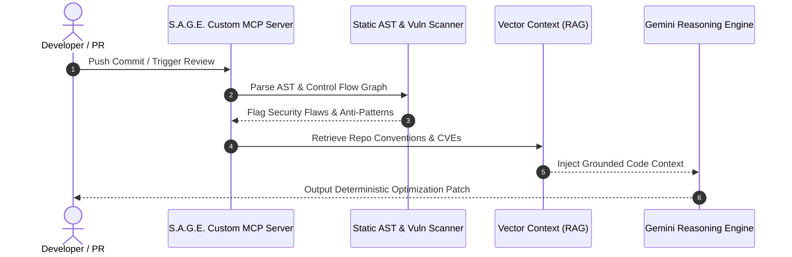
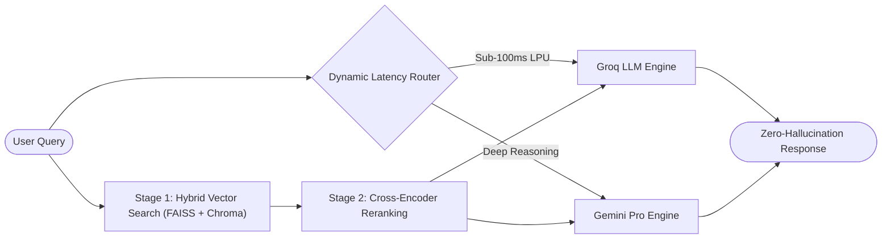
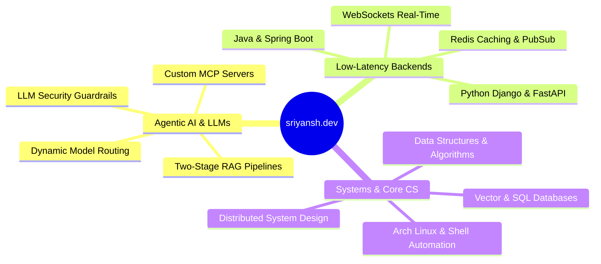

<div align="center">

<!-- ========================================================================================= -->
<!-- 1. ARCH LINUX OLED HEADER & TERMINAL BOOT SEQUENCE (100% VERIFIED URL PARAMETERS)         -->
<!-- ========================================================================================= -->
<a href="https://sriyansh.vercel.app">
  
</a>

<a href="https://sriyansh.vercel.app/?view=know-me">
  
</a>

<br/>

<!-- HARDWARE TTY MULTIPLEXER BAR -->
<kbd><a href="https://sriyansh.vercel.app">⚡ <b>tty1 :: Live Terminal OS</b></a></kbd> · 
<kbd><a href="https://sriyansh.vercel.app/?view=know-me">🐚 <b>tty2 :: AI Shell (know-me.sh)</b></a></kbd> · 
<kbd><a href="https://sriyansh.vercel.app/?view=plan">🧠 <b>tty3 :: System Mindmap</b></a></kbd> · 
<kbd><a href="https://sriyansh.vercel.app/?post=this-counts">🏙️ <b>tty4 :: 3D Isometric Cities</b></a></kbd> · 
<kbd><a href="https://sriyansh.vercel.app/?post=the-scoreboard">📊 <b>tty5 :: The Scoreboard</b></a></kbd>

<br/><br/>

<!-- DARK-OLED COMMAND BADGES -->
<a href="https://sriyansh.vercel.app"></a>
<a href="https://sriyansh.vercel.app/?view=know-me"></a>
<a href="https://linkedin.com/in/sriyanshraj"></a>
<a href="https://leetcode.com/u/sriyansh-dev/"></a>
<a href="https://codolio.com/profile/sriyansh_dev"></a>


</div>

<br/>

> [!IMPORTANT]
> **INTERACTIVE AI SHELL ONLINE (`know-me.sh`)** — Skip static resumes. Query my live first-person Groq-powered AI agent directly in your browser at **[sriyansh.vercel.app/?view=know-me](https://sriyansh.vercel.app/?view=know-me)** or explore my live 3D isometric contribution telemetry at **[sriyansh.vercel.app/?post=this-counts](https://sriyansh.vercel.app/?post=this-counts)**.

---

## `┏━( arch@sriyansh : ~/hypervisor )━[ tmux attach -t 0 ]`

<table width="100%">
<tr>
<td width="52%" valign="top">

```yaml
# ╭─ 01: /etc/sriyansh.conf (fastfetch) ─────────╮
host: "[https://sriyansh.vercel.app](https://sriyansh.vercel.app)"
os: "Arch Linux x86_64 (tty1)"
kernel: "6.12.0-arch1-performance"
role: "Generative AI & Low-Latency Backend Engineer"
shell: "know-me.sh (Groq LPU Conversational Agent)"
uptime: "3x AI/ML Engineering Internships Shipped"

architecture_focus:
  - "Autonomous Agentic Workflows & Custom MCP"
  - "Two-Stage Hybrid RAG (FAISS + ChromaDB)"
  - "Low-Latency Spring Boot & Django Backends"

engineering_doctrine:
  superpower: "Architectural efficiency & clean APIs"
  motto: "No fluff, no filler text, no bloated code."
  status: "[ONLINE] Open to High-Impact Roles"
```

</td>
<td width="48%" valign="top">

```diff
+ ╭─ 02: BTOP // LIVE TELEMETRY & DAEMONS ───────╮

+ AGENTIC AI / MCP / RAG   [███████████████████░] 96%
+ BACKEND / SPRING / REDIS [██████████████████░░] 94%
+ PYTHON / JAVA / TS / C++ [██████████████████░░] 92%
+ VECTOR DB (FAISS/CHROMA) [█████████████████░░░] 90%
+ ALGORITHMS & SYS DESIGN  [█████████████████░░░] 89%

! ACTIVE PRODUCTION DAEMONS (systemctl status)
+ [PID 1042] S.A.G.E.          :: Custom MCP & AST
+ [PID 1088] Vault & BitSwarm  :: 2-Stage Hybrid RAG
+ [PID 1104] know-me.sh        :: Groq LPU Shell CLI
+ [PID 1156] Fact-Check-Engine :: Live DOM Verifier
+ [PID 1204] PyGitLoc / ATS    :: Open-Source Tools
```

</td>
</tr>
</table>

---

## `┏━( arch@sriyansh : ~/interactive-console )━[ ./execute-module.sh ]`
> 💡 **CLICK TO EXECUTE:** Expand any terminal module below to inspect live sequence diagrams, system topologies, or run the interactive recruiter decision tree.

<details open>
<summary><b>🔴 <code>[EXEC 01] $ ./inspect-daemon.sh --target="S.A.G.E. (Agentic Code Review Engine)"</code></b></summary>
<br/>

> **System Spec:** Open-source agentic code-review engine powered by a custom **Model Context Protocol (MCP)** server, Gemini LLMs, and RAG pipelines. Parses repository Abstract Syntax Trees (AST), detects security flaws, and synthesizes deterministic optimization diffs.



</details>

<details>
<summary><b>🟣 <code>[EXEC 02] $ ./inspect-daemon.sh --target="Vault & BitSwarm (Two-Stage Hybrid RAG)"</code></b></summary>
<br/>

> **System Spec:** Autonomous multi-agent knowledge system utilizing **two-stage Retrieval-Augmented Generation (RAG)**, hybrid dense + sparse vector search (`FAISS` / `ChromaDB`), and dynamic model routing between **Groq** and **Gemini** for sub-second inference.



</details>

<details>
<summary><b>🧠 <code>[EXEC 03] $ ./render-mindmap.sh --config="/etc/sriyansh.conf"</code></b></summary>
<br/>



</details>

<details>
<summary><b>🎮 <code>[EXEC 04] $ ./recruiter-ctf.sh --interactive-mode</code> (Playable Terminal Decision Tree)</b></summary>
<br/>

```bash
arch@sriyansh:~$ ./recruiter-ctf.sh
[SYSTEM] Welcome to the sriyansh.dev interactive shell.
[PROMPT] Select a command to execute:
```

<details>
<summary>👉 <b>Command 1:</b> <code>cat /dev/generic_template_portfolio.txt</code></summary>
<br/>

```diff
- [ERROR 404]: File not found.
- Policy enforced: "No fluff, no filler text, and no bloated code."
! Try Command 2 or Command 3 instead.
```
</details>

<details>
<summary>👉 <b>Command 2:</b> <code>ssh root@sriyansh.vercel.app --run="know-me.sh"</code></summary>
<br/>

```diff
+ [SESSION ESTABLISHED]: Connected to Groq LPU conversational agent.
+ Launch live interactive shell: [https://sriyansh.vercel.app/?view=know-me](https://sriyansh.vercel.app/?view=know-me)
```
</details>

<details>
<summary>👉 <b>Command 3:</b> <code>sudo pacman -S sriyansh-engineer --deploy-to-production</code></summary>
<br/>

```diff
+ [DEPENDENCY CHECK PASSED]: Python, Java, Spring Boot, Django, MCP, RAG, Docker, AWS, Redis.
+ Ready for immediate deployment in Backend, Full-Stack, and Agentic AI Engineering roles.
```
👉 **[Connect on LinkedIn](https://linkedin.com/in/sriyanshraj)** · **[Explore Live Terminal OS](https://sriyansh.vercel.app)**
</details>

</details>

---

## `┏━( arch@sriyansh : ~/deployments )━[ ls -la ~/flagship-systems ]`

<div align="center">

| System Daemon | Architecture & Engineering Scope | Tech Stack |
| :--- | :--- | :--- |
| 🔴 **[S.A.G.E. (AI Code Reviewer)](https://github.com/sriyansh-dev/S.A.G.E)** | Open-source agentic code-review engine with a custom **Model Context Protocol (MCP)** server and Gemini/RAG pipeline that detects bugs, security flaws, and automates optimization. | `Python` `MCP` `Gemini` `RAG` `MERN` |
| 🟣 **[Vault & BitSwarm RAG](https://sriyansh.vercel.app)** | Autonomous agentic knowledge engine featuring **two-stage RAG**, hybrid vector search (`FAISS`/`Chroma`), and dynamic model routing (`Groq`/`Gemini`). | `Python` `LangChain` `FAISS` `Groq` |
| 🟢 **[Arch Terminal OS (`know-me.sh`)](https://sriyansh.vercel.app/?view=know-me)** | Zero-framework OLED space terminal featuring a live first-person Groq AI shell, 3D isometric contribution cities, and real-time telemetry. | `Vanilla JS` `HTML5` `CSS3` `Python` |
| 🔵 **AI Fact-Checking Extension** | Browser-native verification pipeline that captures live web claims and cross-examines them against vector-indexed ground truth. | `JavaScript` `Django` `LangChain` `Chroma` |
| 🟡 **AI Grievance Redressal** | End-to-end Web & Android platform utilizing structured REST contracts and automated server-side ticket routing. | `TypeScript` `Python` `Android` |
| 🟠 **GAN Colorization & NLP Parser** | Trained Deep GAN for image restoration (`Streamlit`) + end-to-end NLP resume entity extraction pipeline. | `PyTorch` `TensorFlow` `Scikit-learn` |

</div>

<br/>

<div width="100%" align="center">
  <a href="https://github.com/sriyansh-dev/S.A.G.E">
    
  </a>
  <a href="https://github.com/sriyansh-dev/ai-interview-prep-engine">
    
  </a>
</div>

---

## `┏━( arch@sriyansh : ~/packages )━[ pacman -Qe --tech-arsenal ]`

<div align="center">

<a href="https://sriyansh.vercel.app">
  
</a>
<br/><br/>
<a href="https://sriyansh.vercel.app/?view=plan">
  
</a>

<br/><br/>


</div>

---

## `┏━( arch@sriyansh : ~/var/log )━[ journalctl -u experience-and-audits.service ]`

```diff
+ [SHIPPED] Generative AI Intern :: Prabandhan & EiSystems Technologies
  ↳ Engineered production LLM workflows, adversarial prompt guardrails, and low-latency RAG pipelines.

+ [SHIPPED] AI & ML Engineering Intern :: Codomax Digital Solutions
  ↳ Optimized high-throughput ML inference services, data pipelines, and backend API integrations.

+ [PUBLISHED] Open-Source Author :: PyGitLoc & Automated ATS-Checker
  ↳ Built and released developer CLI telemetry tools and NLP document parsing pipelines.

! [VERIFIED SECURITY & ENGINEERING CREDENTIALS]
  ├─ Certified LLM Security Professional (Adversarial Robustness & Guardrails)
  ├─ Google AI Essentials & Generative AI Architecture
  ├─ Deloitte Data Analytics & Systems Simulation (Forage)
  ├─ Big Data & Data Science Engineering Bootcamp (C-DAC)
  └─ Advanced C++ Systems Training
```

---

## `┏━( arch@sriyansh : ~/telemetry )━[ btop --utf-force --theme=arch-oled ]`

<div align="center">

<a href="https://sriyansh.vercel.app/?post=this-counts">
  
</a>
<a href="https://sriyansh.vercel.app/?post=the-scoreboard">
  
</a>

<br/>

<a href="https://github.com/sriyansh-dev">
  
</a>
<a href="https://sriyansh.vercel.app/?post=this-counts">
  
</a>

<br/><br/>

<a href="https://github.com/sriyansh-dev">
  
</a>

<br/>


</div>

---

<div align="center">

```bash
arch@sriyansh:~$ echo "No fluff, no filler text, and no bloated code."
```

<kbd><a href="https://sriyansh.vercel.app">🚀 <b>LAUNCH LIVE TERMINAL PORTFOLIO (sriyansh.vercel.app)</b></a></kbd> · 
<kbd><a href="https://sriyansh.vercel.app/?view=know-me">🐚 <b>CHAT WITH MY AI (know-me.sh)</b></a></kbd> · 
<kbd><a href="https://linkedin.com/in/sriyanshraj">💼 <b>CONNECT ON LINKEDIN</b></a></kbd>


</div>
